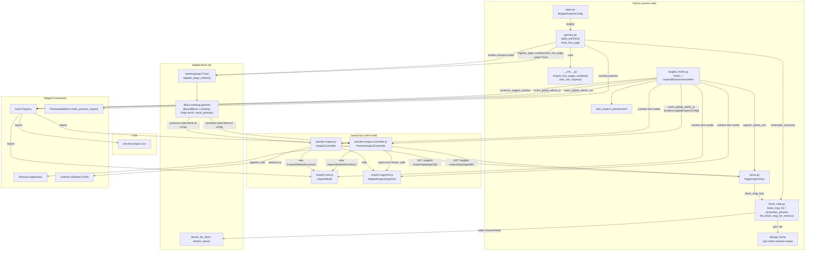
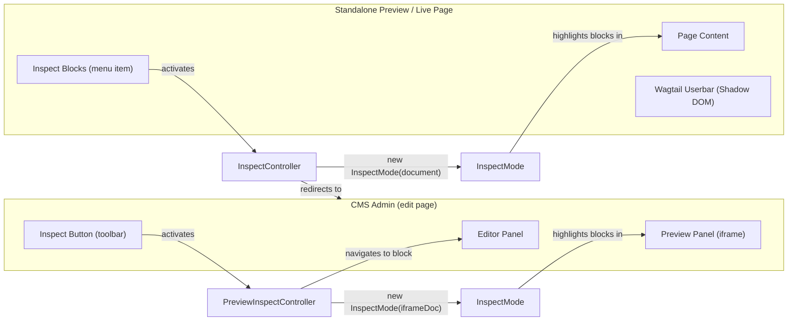
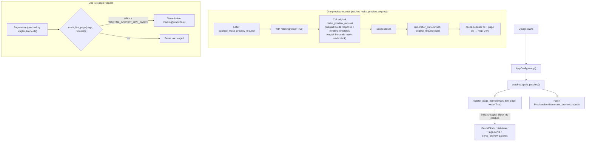
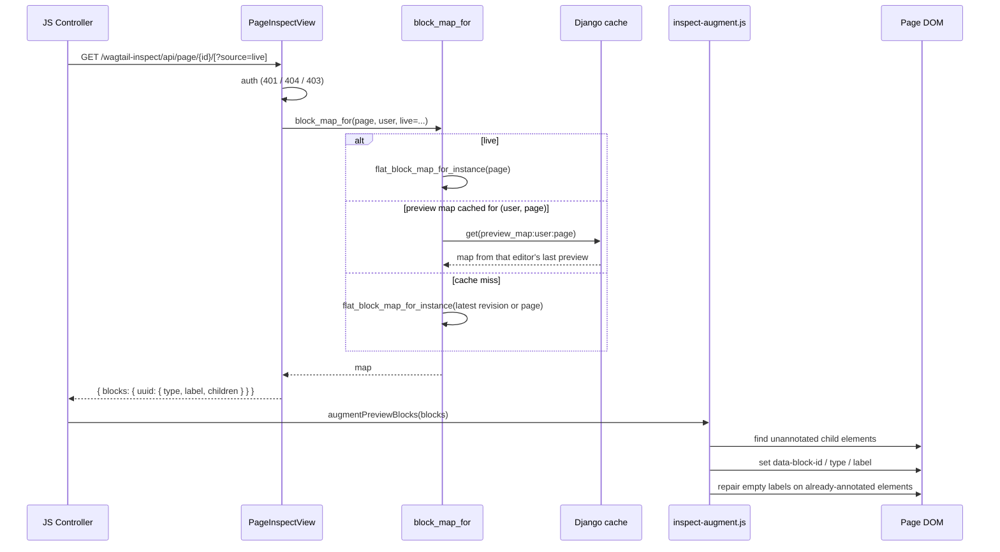
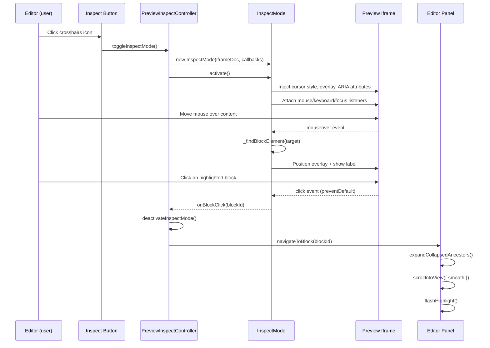
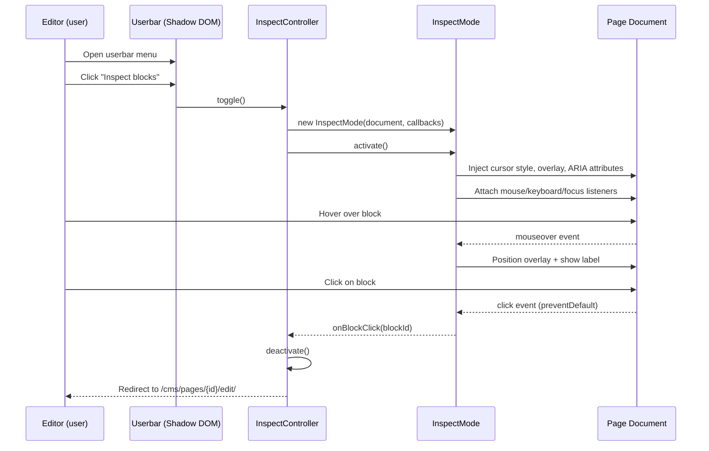
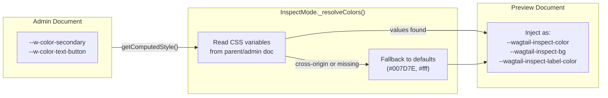

# Architecture Overview

This document describes how the Wagtail Inspect plugin is structured, how data flows through it, and how its components interact.

## Core Idea

Wagtail renders StreamField content as plain HTML -- there is no built-in way to trace a rendered block back to the editor panel that produced it. This plugin closes that gap by:

1. **Marking** every rendered UUID-bearing block with `data-block-id`, `data-block-type`, and `data-block-label`. The marking itself lives in the [wagtail-block-ids](https://github.com/lincolnloop/wagtail-block-ids) package (shared with wagtail-live-comments); wagtail-inspect only decides **when** to mark: inside the preview render (a patch on `PreviewableMixin.make_preview_request`) and on live pages served to users who can edit them (a registered page marker).
2. **Augmenting** any blocks the server-side marks missed (e.g. blocks rendered via `django-includecontents` or raw template loops) using `inspect-augment.js`, which reads a block map built from the page's data model by `block_map.py`.
3. **Remembering** the block map of each editor's last preview render in Django's cache, so the API serves UUIDs that match the unsaved preview HTML.
4. **Detecting** those marked elements in the page and letting the user hover/click them (JavaScript-side controllers).
5. **Navigating** from the clicked block back to the correct editor section in the Wagtail admin (DOM traversal, panel expansion, scroll, flash highlight).

## High-Level Component Map



## Two Integration Modes

The plugin operates in two distinct contexts, each with its own JavaScript controller. Both controllers delegate the visual inspect experience to the shared `InspectMode` class:



### Mode 1: CMS Preview Panel (iframe)

Used when an editor has the page open in the Wagtail admin at `/cms/pages/{id}/edit/` and toggles the side preview panel.

- **Controller**: `PreviewInspectController` (Stimulus)
- **Where it runs**: In the admin page, interacting with the preview iframe's document
- **InspectMode target**: `iframe.contentDocument` (cross-frame)
- **Navigation**: In-page -- finds the `[data-contentpath]` element in the editor panel, expands collapsed panels, scrolls to it, and flashes a highlight
- **File**: `preview-inspect-controller.js`

### Mode 2: Standalone Preview Page or Live Page (userbar)

Used when an editor opens the full preview at `/cms/pages/{id}/edit/preview/`, or visits the published page while logged in as a user who can edit it (`WAGTAIL_INSPECT_LIVE_PAGES`, default `True`). Anonymous visitors and users without edit permission get neither the userbar item nor marked HTML.

- **Controller**: `InspectController` (plain JS)
- **Where it runs**: Directly on the page's document
- **Block map**: the userbar item's `apiUrl` carries `?source=live` on live pages, so the API serves the published page's map
- **InspectMode target**: `document` (same frame)
- **Navigation**: Full-page redirect to `/cms/pages/{id}/edit/#block-{uuid}-section`
- **File**: `userbar-inspect.js`

## Block Rendering Pipeline

Blocks are marked by [wagtail-block-ids](https://github.com/lincolnloop/wagtail-block-ids). It patches `BoundBlock.render` / `render_as_block`, `ListValue.__iter__`, `Page.serve`, and `PreviewableMixin.serve_preview`, and marks blocks only while a `marking()` scope is open. Its README and the `wagtail_block_ids.marks` module docstring describe how marks are written; this repo does not re-implement any of it.

wagtail-inspect opens those scopes in two places, both set up at Django startup (`AppConfig.ready()` → `patches.apply_patches()`):

| What | Where | Role |
| ---- | ----- | ---- |
| `PreviewableMixin.make_preview_request` patch | `patches.patched_make_preview_request` | Runs Wagtail's original method inside `marking(wrap=True)`, then calls `remember_preview(self, original_request.user)` to store the block map of what was just rendered. |
| Page marker | `patches.mark_live_page`, registered with `register_page_marker(mark_live_page, wrap=True)` | wagtail-block-ids asks it on every page serve (live and preview). It returns true when `WAGTAIL_INSPECT_LIVE_PAGES` is on (default) and `user_can_inspect(page, request.user)` (authenticated, `can_edit()`). Anonymous and non-editor responses are untouched. With the setting off, previews are still marked through the patch above. |

**Guards and shared logic**

- **Only UUID-bearing blocks** (stream and list children) are marked; wagtail-block-ids skips bound blocks without an `.id`.
- **`wrap=True`** in both scopes lets blocks with no single root element (multi-root fragments, text-only output) get a `<div style="display:contents">` wrapper the overlay can measure. Without it, text-only blocks would stay unmarked and multi-root blocks would only have their first element marked.
- **Type and label** on the wire come from wagtail-block-ids' `describe()` / `BlockInfo`, the same walk `flat_block_map_for_instance` uses, so marked DOM and the API map agree.
- **Startup:** `_apply_patch` skips if already applied and **logs and continues** if the target is missing or raises; the live marker is registered once. Patch installation and the Wagtail version warning for wagtail-block-ids' own patches happen inside that package.

### What the marks look like

**Single root element:** the three attributes go on the block's own root tag. No wrapper is emitted, so CSS Grid and Flexbox layouts are unaffected.

```html
<!-- Before marking -->
<section class="hero">…</section>

<!-- After marking -->
<section data-block-id="…" data-block-type="hero" data-block-label="Hero" class="hero">…</section>
```

**Several roots, loose text beside the root, or no element at all** (e.g. a markdown block rendering sibling `<p>` tags, or a bare `CharBlock`): because inspect's scopes use `wrap=True`, the whole fragment is wrapped in `<div data-block-… style="display:contents">`, so the whole block shares one `data-block-id` and the wrapper generates no layout box.

`_getBlockRect()` in `InspectMode` handles both cases:

```javascript
_getBlockRect(element) {
    const rect = element.getBoundingClientRect();
    if (rect.width > 0 || rect.height > 0) return rect;
    // Fallback for display:contents wrappers — union direct child rects
    // (Range API only as last resort for text-only wrappers with no element children)
    ...
}
```

### End-to-end preview timeline

1. Editor triggers preview → Wagtail calls `PreviewableMixin.make_preview_request` (patched).
2. The patch enters `marking(wrap=True)` and calls the **original** method. Every block rendered inside it (template render included) is marked by wagtail-block-ids.
3. The scope closes when the original returns (or raises; the context manager always resets it).
4. On success, the patch calls `remember_preview(self, user)`, where `user` comes from the `original_request` argument. By then `self` holds the form-submitted preview data, so the stored map's UUIDs match the HTML just produced.
5. `remember_preview` writes the map to Django's cache under `wagtail_inspect:preview_map:<user pk>:<page pk>` for `PREVIEW_MAP_TIMEOUT` (24 hours). It does nothing when the object has no pk or there is no authenticated user.



### Where the cache lives

The preview map is stored with Django's default cache (`django.core.cache.cache`). With a shared backend (Redis, Memcached, database) every worker sees it, so the API request can land on a different process than the preview render. With the default `LocMemCache` it is per process, and a request served by another worker falls back to the latest revision (see below). Maps are kept per editor, so one editor's unsaved preview never shows up in another's inspector.

## Block Map Augmentation Pipeline

Some blocks are never marked on the server because their DOM nodes are built without going through `BoundBlock.render` / `render_as_block` (e.g. `django-includecontents`, or hand-written loops over field values). **`flat_block_map_for_instance`** still knows the tree from the page model, so the API + **`inspect-augment.js`** can attach `data-block-*` in the page after load.

### API: which map is served

`PageInspectView` (GET `/wagtail-inspect/api/page/<id>/`) checks access (401 anonymous, 404 missing page, 403 without `can_edit()`), then returns `{"blocks": block_map_for(page, request.user, live=request.GET.get("source") == "live")}`. `block_map_for` picks the map:

1. **Live** (`?source=live`, sent by the userbar on live pages) — the published page's map, ignoring previews and revisions.
2. **That editor's last preview** — the map `remember_preview` stored for (user, page), so UUIDs match the **current** preview HTML, including unsaved editor state.
3. **Latest revision** — `get_latest_revision().as_object()`, e.g. a standalone preview after the cache entry expired or on another worker without a shared cache.
4. **The page itself** — when there is no revision.



`PreviewInspectController` injects `inspect-augment.js` into the **preview iframe** before calling `augmentPreviewBlocks`, because the script must run in the same document as the DOM it mutates. The userbar path loads the same script (through the userbar item's `media`) on the standalone preview or live page, then calls `WagtailInspectAugment.augmentPreviewBlocks` on `document`.

## Inspect Mode Interaction Flow

### CMS Preview Panel



### Standalone Preview Page



## Theme Bridging

The inspect overlay needs to match Wagtail's active theme (light, dark, or auto). Since the preview iframe may not have Wagtail's CSS variables, `InspectMode` bridges the theme at activation time:



## Cross-Frame Communication

- **Standalone preview / live page** (`userbar-inspect.js`): the userbar runs on the page itself; clicking a block sets `window.location` to the edit URL with `#block-{uuid}-section` (full navigation, no `postMessage`).
- **Editor preview panel** (`preview-inspect-controller.js`): `InspectMode` runs in the **iframe** document; clicking a block calls `navigateToBlock()` in the **parent** admin window (same process, direct DOM access — no `postMessage` for navigation). `inspect-augment.js` is injected into the iframe so it runs in the iframe's document context and can annotate the iframe's DOM directly.

## URL Hash Convention

The plugin uses a URL hash format to deep-link to specific blocks:

```
#block-{uuid}-section
```

This hash is:

- Set by `navigateToBlock()` via `history.pushState()` in the CMS admin
- Used as the target anchor when the userbar redirects to the edit page
- Detected on page load by `scrollToHashBlock()` to auto-navigate after redirect (uses instant scroll to avoid layout-shift interference from Wagtail's side panels)

## Data Attributes Reference

| Attribute                             | Where                                                            | Purpose                                                                           |
| ------------------------------------- | ---------------------------------------------------------------- | --------------------------------------------------------------------------------- |
| `data-block-id`                       | Preview / editor's live HTML (block root element, or `display:contents` wrapper) | UUID of the StreamField block                                                     |
| `data-block-type`                     | Preview HTML (same element)                                      | Block type slug (e.g., `"hero"`, `"stat_list_block"`)                             |
| `data-block-label`                    | Preview HTML (same element)                                      | Human-readable block label (e.g., "Hero", "Stat List")                            |
| `data-contentpath`                    | Admin editor panel                                               | Wagtail's native attribute on block editor sections, value matches the block UUID |
| `data-controller`                     | Admin preview panel                                              | Stimulus controller identifier (`w-preview preview-inspect`)                      |
| `data-w-preview-target`               | Admin preview panel                                              | Stimulus target for the preview iframe (`iframe`)                                 |
| `data-preview-inspect-button`         | Admin preview toolbar                                            | Marker on the injected inspect button                                             |
| `data-wagtail-inspect-userbar-target` | Userbar template                                                 | Target for the inspect trigger button (`trigger`)                                 |
