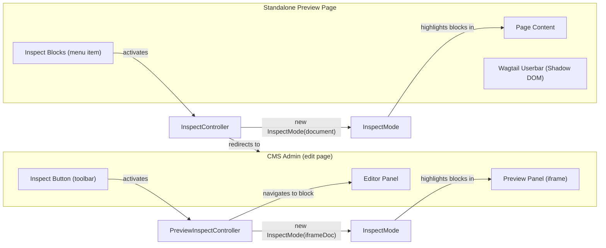
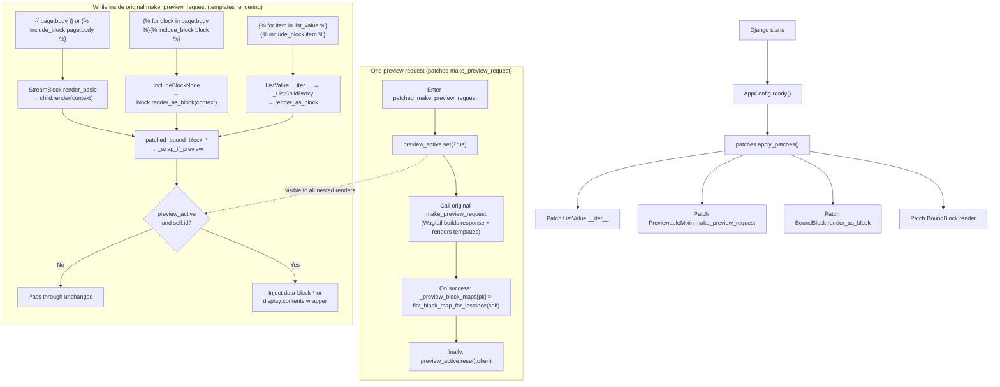
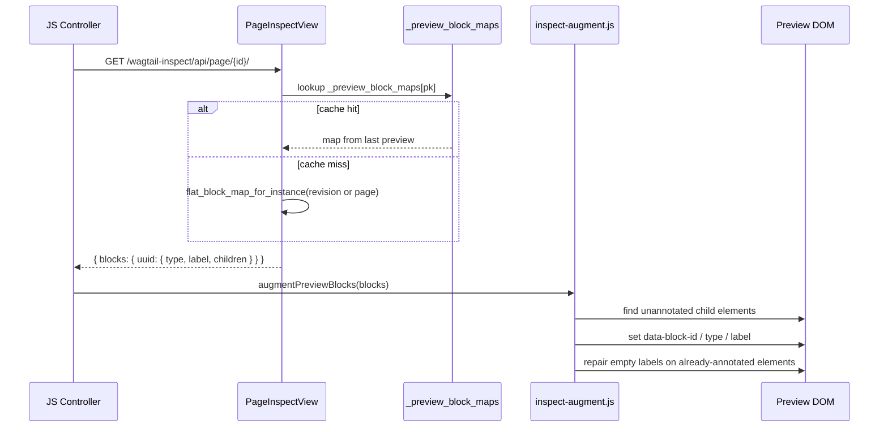
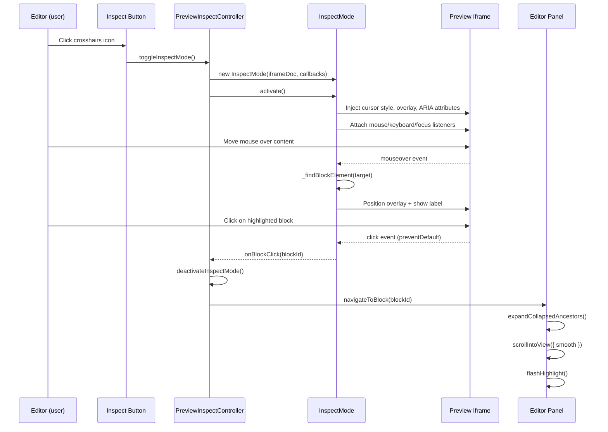
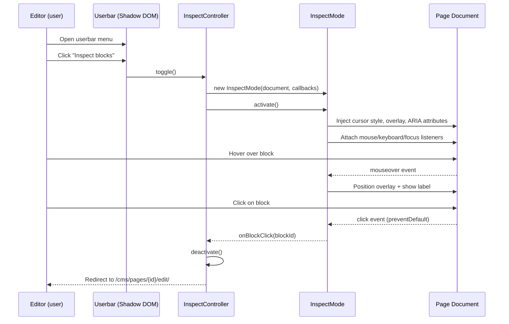
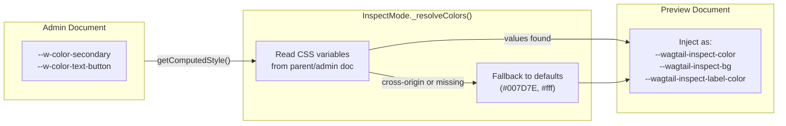

# Architecture Overview

This document describes how the Wagtail Inspect plugin is structured, how data flows through it, and how its components interact.

## Core Idea

Wagtail renders StreamField content as plain HTML -- there is no built-in way to trace a rendered block back to the editor panel that produced it. This plugin closes that gap by:

1. **Tagging** every rendered `BoundBlock` with `data-block-id`, `data-block-type`, and `data-block-label` attributes (Python-side monkey-patches on `BoundBlock.render`, `BoundBlock.render_as_block`, and `ListValue.__iter__`).
2. **Augmenting** any blocks the Python patches missed (e.g. blocks rendered via `django-includecontents` or raw template loops) using `inspect-augment.js`, which reads a block map built from the page's data model by `block_map.py`.
3. **Signalling** preview mode via a `ContextVar` set by a patch on `PreviewableMixin.make_preview_request`, rather than thread-local state or URL matching.
4. **Detecting** those tagged elements in the preview and letting the user hover/click them (JavaScript-side controllers).
5. **Navigating** from the clicked block back to the correct editor section in the Wagtail admin (DOM traversal, panel expansion, scroll, flash highlight).

## High-Level Component Map

```mermaid
graph TD
  subgraph python ["Python (server-side)"]
    Init["__init__.py\npreview_active ContextVar\n_preview_block_maps cache"]
    AppConfig["apps.py\nWagtailInspectConfig"]
    Patches["patches.py\napply_patches()"]
    BlockMap["block_map.py\nflat_block_map_for_instance"]
    Views["views.py\nPageInspectView"]
    Hooks["wagtail_hooks.py\nhooks + InspectBlocksUserbarItem"]
    Template["item_inspect_preview.html"]
  end

  subgraph js ["JavaScript (client-side)"]
    InspectCore["inspect-core.js\nInspectMode"]
    AugmentJS["inspect-augment.js\nWagtailInspectAugment"]
    PreviewCtrl["preview-inspect-controller.js\nPreviewInspectController"]
    UserbarCtrl["userbar-inspect.js\nInspectController"]
  end

  subgraph css ["CSS"]
    Styles["preview-inspect.css"]
  end

  subgraph wagtail ["Wagtail Framework"]
    StimulusApp["Stimulus Application"]
    WagtailHooks["Hook Registry"]
    BlockRendering["Block Rendering\n(BoundBlock.render / render_as_block)"]
    ListIter["ListValue.__iter__\n(list block loops)"]
    PreviewMixin["PreviewableMixin.make_preview_request"]
    UserbarShadow["Userbar (Shadow DOM)"]
  end

  AppConfig -->|"ready()"| Patches
  Patches -->|"monkey-patches"| BlockRendering
  Patches -->|"monkey-patches"| ListIter
  Patches -->|"monkey-patches"| PreviewMixin
  Patches -->|"reads / sets"| Init
  Patches -->|"imports"| BlockMap

  PreviewMixin -->|"after original returns: snapshots"| Init
  BlockMap --> Init

  Views -->|"reads _preview_block_maps"| Init
  Views -->|"imports"| BlockMap

  Hooks -->|"insert_global_admin_css"| WagtailHooks
  Hooks -->|"insert_global_admin_js"| WagtailHooks
  Hooks -->|"insert_global_admin_js\n(window.wagtailInspectConfig)"| PreviewCtrl
  Hooks -->|"register_admin_urls"| Views
  Hooks -->|"construct_wagtail_userbar"| WagtailHooks

  Hooks --> Template
  Template -->|"loads dynamically"| InspectCore
  Template -->|"loads dynamically"| AugmentJS
  Template -->|"loads dynamically"| UserbarCtrl

  WagtailHooks -->|"injects"| Styles
  WagtailHooks -->|"injects"| InspectCore
  WagtailHooks -->|"injects"| PreviewCtrl

  PreviewCtrl -->|"new InspectMode(iframeDoc)"| InspectCore
  UserbarCtrl -->|"new InspectMode(document)"| InspectCore

  PreviewCtrl -->|"registers with"| StimulusApp
  UserbarCtrl -->|"attaches to"| UserbarShadow

  PreviewCtrl -->|"GET /wagtail-inspect/api/page/{id}/"| Views
  PreviewCtrl -->|"injects into iframe, calls"| AugmentJS
  UserbarCtrl -->|"GET /wagtail-inspect/api/page/{id}/"| Views
  UserbarCtrl -->|"calls"| AugmentJS

  BlockRendering -->|"produces data-block-id HTML"| PreviewCtrl
  BlockRendering -->|"produces data-block-id HTML"| UserbarCtrl
```



## Two Integration Modes

The plugin operates in two distinct contexts, each with its own JavaScript controller. Both controllers delegate the visual inspect experience to the shared `InspectMode` class:



### Mode 1: CMS Preview Panel (iframe)

Used when an editor has the page open in the Wagtail admin at `/cms/pages/{id}/edit/` and toggles the side preview panel.

- **Controller**: `PreviewInspectController` (Stimulus)
- **Where it runs**: In the admin page, interacting with the preview iframe's document
- **InspectMode target**: `iframe.contentDocument` (cross-frame)
- **Navigation**: In-page -- finds the `[data-contentpath]` element in the editor panel, expands collapsed panels, scrolls to it, and flashes a highlight
- **File**: `preview-inspect-controller.js`

### Mode 2: Standalone Preview Page (userbar)

Used when an editor opens the full preview at `/cms/pages/{id}/edit/preview/`.

- **Controller**: `InspectController` (plain JS)
- **Where it runs**: Directly on the preview page's document
- **InspectMode target**: `document` (same frame)
- **Navigation**: Full-page redirect to `/cms/pages/{id}/edit/#block-{uuid}-section`
- **File**: `userbar-inspect.js`

## Block Rendering Pipeline

The Python side patches Wagtail so that **during preview only**, UUID-bearing blocks get `data-block-*` on their HTML. Patches are installed once at Django startup (`AppConfig.ready()` → `apply_patches()`). **Live pages** (no preview) see `preview_active` false, so `BoundBlock` output is unchanged and `ListValue.__iter__` delegates to Wagtail’s original iterator.

### The four patches (what wraps what)

| Order in `apply_patches()` | Target | Patched method | Role |
| -------------------------- | ------ | -------------- | ---- |
| 1 | `wagtail.blocks.BoundBlock` | `render` | After each child render from stream-level paths, run `_wrap_if_preview` when preview + `.id`. |
| 2 | `BoundBlock` | `render_as_block` | Same wrapper when templates use explicit ``. |
| 3 | `PreviewableMixin` | `make_preview_request` | Sets `preview_active` for the **entire** call to Wagtail’s original implementation, then snapshots the block map; `finally` resets the token. |
| 4 | `wagtail.blocks.list_block.ListValue` | `__iter__` | If `preview_active`: yield `_ListChildProxy` per `bound_blocks` so loops still see value-like objects but `` hits `render_as_block` with a UUID; else call stock `__iter__`. |

**Guards and shared logic**

- **Wrapping** only runs when `preview_active.get()` is true **and** `getattr(self, "id", None)` is set (StreamField / list children with UUIDs). Plain `BoundBlock` instances without `.id` are left alone.
- **Type and label** on the wire come from `block_map.resolve_block_type` / `resolve_block_label` inside `_wrap_if_preview`, so Python-tagged DOM matches the semantics of `flat_block_map_for_instance`.
- **Startup:** each patch goes through `_apply_patch`, which skips if already applied and **logs and continues** if a target is missing or raises — the site should still boot.
- **Wagtail version:** if `wagtail.VERSION` is outside `TESTED_WAGTAIL_VERSIONS` (5 / 6 / 7), `apply_patches()` logs a warning; patches still run.

### End-to-end preview timeline

1. Editor triggers preview → Wagtail calls `PreviewableMixin.make_preview_request` (patched).
2. Patch sets `preview_active` token, then calls the **original** method. Everything that runs inside that call (including template render) sees `preview_active.get() == True`.
3. Stream templates hit `patched_bound_block_render` / `patched_bound_block_render_as_block` → `_wrap_if_preview`.
4. List templates iterate a `ListValue` → `patched_list_value_iter` yields proxies → `` → `render_as_block` → same `_wrap_if_preview`.
5. Original `make_preview_request` returns → patch stores `_preview_block_maps[page_pk] = flat_block_map_for_instance(self)` (UUIDs aligned with the HTML just produced), then **`finally`** resets `preview_active`.

**After step 5**, the ContextVar is false again, so any code that runs later in the same thread of execution but outside that preview scope does not wrap blocks.



### Four patches, two `BoundBlock` rendering entry points

Besides preview lifecycle and list iteration (see below), two `BoundBlock` methods are patched because Wagtail templates use two distinct rendering paths:

| Template syntax                                         | Wagtail method patched       | Patch function                        | Notes                                               |
| ------------------------------------------------------- | ---------------------------- | ------------------------------------- | --------------------------------------------------- |
| `{{ page.body }}` or ``    | `BoundBlock.render`          | `patched_bound_block_render`          | Called by `StreamBlock.render_basic` for each child |
| `` | `BoundBlock.render_as_block` | `patched_bound_block_render_as_block` | Called by `IncludeBlockNode` when iterating         |

Both methods delegate to `self.block.render(self.value, context)` internally; they never call each other, so there is no double-annotation.

`ListValue.__iter__` is patched so that during preview, `` yields `_ListChildProxy` objects that still behave like values but carry UUIDs for wrapping. `PreviewableMixin.make_preview_request` is patched to set `preview_active` around the preview request and snapshot `flat_block_map_for_instance` into `_preview_block_maps` after the response is built.

### Preview Detection via ContextVar

Preview detection uses a `ContextVar[bool]` named `preview_active` (defined in `__init__.py`), set by patching `PreviewableMixin.make_preview_request`:

```mermaid
sequenceDiagram
  participant Wagtail as Wagtail (caller)
  participant Patch as patched_make_preview_request
  participant CV as preview_active (ContextVar)
  participant Inner as original make_preview_request
  participant Render as BoundBlock.render / ListValue.__iter__
  participant Cache as _preview_block_maps

  Wagtail->>Patch: make_preview_request(...)
  Patch->>CV: set(True) → token
  Patch->>Inner: call original(self, *args, **kwargs)
  Note over Inner,Render: Template render runs here; nested code uses preview_active
  Inner->>Render: block rendering / list iteration
  Render->>CV: get() → True
  Render->>Render: wrap output or yield proxy
  Inner-->>Patch: response
  Patch->>Cache: _preview_block_maps[pk] = flat_block_map_for_instance(self)
  Patch->>CV: reset(token) [in finally, even on error]
  Patch-->>Wagtail: response
```

`ContextVar` is async-safe (unlike `threading.local`) and is visible to all rendering calls that happen **inside** the original `make_preview_request` without passing anything through the Django template context.

The block map snapshot runs **after** the original method returns successfully, still inside the patch body but **before** `preview_active.reset`. By then `self` reflects form-submitted preview data, so the map’s UUIDs match the HTML in the response, even when Wagtail’s preview round-trip assigns different UUIDs than the saved revision.

### Why `ListValue.__iter__` is separate from the two `BoundBlock` patches

`ListChild` objects are `BoundBlock` subclasses, so `render` / `render_as_block` already wrap them **when** the template reaches them through ``. The problem is templates that loop with ``: Wagtail’s default `ListValue.__iter__` can yield plain values, so `include_block` never receives a UUID-bearing bound block. The preview-only iterator swaps in `_ListChildProxy` so the same templates keep working (`item.field`, ``, etc.) while inspect wrapping can attach to list items.

### Why `BoundBlock` Instead of `IncludeBlockNode`

`BoundBlock` is the common base class of both `StreamValue.StreamChild` and `ListValue.ListChild`. Patching at this level:

- Covers **both** stream rendering entry points (`render` for stream-level iteration, `render_as_block` for explicit ``).
- **Covers `ListChild`** when they are rendered through those methods (and the `ListValue` patch fixes loops that would otherwise bypass them).
- Guards against wrapping by checking `getattr(self, "id", None)` — plain `BoundBlock` instances with no `.id` are silently skipped.

### Block Annotation Strategy

Block metadata is attached to the DOM using a three-path strategy in `_wrap_if_preview`:

**Primary — attribute injection:** `_inject_attrs_into_root` locates the first HTML element in the rendered output via a compiled regex and inserts `data-block-id`, `data-block-type`, and `data-block-label` directly into that element's opening tag. No wrapper element is emitted, so CSS Grid and Flexbox layouts are completely unaffected.

```html
<!-- Before annotation -->
<section class="hero">…</section>

<!-- After annotation -->
<section data-block-id="…" data-block-type="hero" data-block-label="Hero" class="hero">…</section>
```

**Multi-root wrapper:** when the rendered output contains more than one top-level HTML element (e.g. a markdown block rendered as several sibling `<p>` tags), injecting on the first tag would only annotate part of the block. In this case, a `<div style="display:contents">` wrapper is emitted around the full fragment so the whole block shares one `data-block-id`. `_is_multi_root_fragment` (backed by `_RootCounter`, an `HTMLParser` subclass) detects this case in a single pass.

**Text-only fallback:** when the block output contains no HTML element (e.g. a bare `CharBlock` rendering plain text), the same `<div style="display:contents">` wrapper is used. Text-only output cannot be a grid item, so layout impact is moot.

`_getBlockRect()` in `InspectMode` handles all three cases:

```javascript
_getBlockRect(element) {
    const rect = element.getBoundingClientRect();
    if (rect.width > 0 || rect.height > 0) return rect;
    // Fallback for display:contents wrappers — union direct child rects
    // (Range API only as last resort for text-only wrappers with no element children)
    ...
}
```

## Block Map Augmentation Pipeline

Some blocks are invisible to the Python rendering patches because their DOM nodes are built without going through `BoundBlock.render` / `render_as_block` (e.g. `django-includecontents`, or hand-written loops over field values). **`flat_block_map_for_instance`** still knows the tree from the page model, so the API + **`inspect-augment.js`** can attach `data-block-*` in the preview document after load.

### API: live preview map vs revision fallback

`PageInspectView` (GET `/wagtail-inspect/api/page/<id>/`) chooses the map in this order:

1. **In-memory cache** — If `page.pk` exists in `_preview_block_maps`, return that dict immediately. This is the snapshot taken at the end of the last `make_preview_request` for this page, so UUIDs match the **current** preview HTML (including unsaved editor state).
2. **Fallback** — Otherwise build from `get_latest_revision().as_object()` if a revision exists, else the live page. Used after a full reload of standalone preview, or any caller that hits the API without a recent preview render in this process.

Authenticated editors with `can_edit()` only; otherwise 401/403/404 as appropriate.



`PreviewInspectController` injects `inspect-augment.js` into the **preview iframe** before calling `augmentPreviewBlocks`, because the script must run in the same document as the DOM it mutates. The userbar path loads the same script on the standalone preview page, then calls `WagtailInspectAugment.augmentPreviewBlocks` on `document`.

## Inspect Mode Interaction Flow

### CMS Preview Panel



### Standalone Preview Page



## Theme Bridging

The inspect overlay needs to match Wagtail's active theme (light, dark, or auto). Since the preview iframe may not have Wagtail's CSS variables, `InspectMode` bridges the theme at activation time:



## Cross-Frame Communication

- **Standalone preview** (`userbar-inspect.js`): the userbar runs on the preview page; clicking a block sets `window.location` to the edit URL with `#block-{uuid}-section` (full navigation, no `postMessage`).
- **Editor preview panel** (`preview-inspect-controller.js`): `InspectMode` runs in the **iframe** document; clicking a block calls `navigateToBlock()` in the **parent** admin window (same process, direct DOM access — no `postMessage` for navigation). `inspect-augment.js` is injected into the iframe so it runs in the iframe's document context and can annotate the iframe's DOM directly.

## URL Hash Convention

The plugin uses a URL hash format to deep-link to specific blocks:

```
#block-{uuid}-section
```

This hash is:

- Set by `navigateToBlock()` via `history.pushState()` in the CMS admin
- Used as the target anchor when the userbar redirects to the edit page
- Detected on page load by `scrollToHashBlock()` to auto-navigate after redirect (uses instant scroll to avoid layout-shift interference from Wagtail's side panels)

## Data Attributes Reference

| Attribute                             | Where                                                            | Purpose                                                                           |
| ------------------------------------- | ---------------------------------------------------------------- | --------------------------------------------------------------------------------- |
| `data-block-id`                       | Preview HTML (block root element, or `display:contents` wrapper) | UUID of the StreamField block                                                     |
| `data-block-type`                     | Preview HTML (same element)                                      | Block type slug (e.g., `"hero"`, `"stat_list_block"`)                             |
| `data-block-label`                    | Preview HTML (same element)                                      | Human-readable block label (e.g., "Hero", "Stat List")                            |
| `data-contentpath`                    | Admin editor panel                                               | Wagtail's native attribute on block editor sections, value matches the block UUID |
| `data-controller`                     | Admin preview panel                                              | Stimulus controller identifier (`w-preview preview-inspect`)                      |
| `data-w-preview-target`               | Admin preview panel                                              | Stimulus target for the preview iframe (`iframe`)                                 |
| `data-preview-inspect-button`         | Admin preview toolbar                                            | Marker on the injected inspect button                                             |
| `data-wagtail-inspect-userbar-target` | Userbar template                                                 | Target for the inspect trigger button (`trigger`)                                 |
