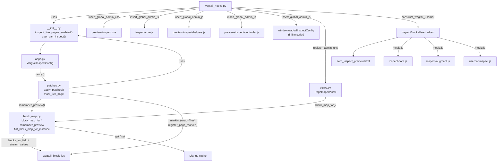

# Python Backend Deep Dive

This document covers every Python module in the plugin: the package initialization with its permission and settings helpers, the block map data layer and per-editor preview cache, the Django app configuration that boots the patches, the preview patch and live-page marker, the API view, and the Wagtail hooks that wire front-end assets and the userbar item.

Marking rendered blocks with `data-block-*` attributes is **not** done here. It lives in [wagtail-block-ids](https://github.com/lincolnloop/wagtail-block-ids) (`wagtail_block_ids.marks` patches `BoundBlock.render` / `render_as_block`, `ListValue.__iter__`, `Page.serve`, and `PreviewableMixin.serve_preview`; `wagtail_block_ids.blocks` walks StreamField values). See that package's README and module docstrings for how marks are written. This document only covers how wagtail-inspect uses it.

## Table of Contents

- [Module overview](#module-overview)
- [`__init__.py` -- Package initialization](#__init__py----package-initialization)
- [`apps.py` -- Django app configuration](#appspy----django-app-configuration)
- [`block_map.py` -- Block maps and the preview cache](#block_mappy----block-maps-and-the-preview-cache)
  - [`flat_block_map_for_instance`](#flat_block_map_for_instance)
  - [`remember_preview`](#remember_preview)
  - [`block_map_for`](#block_map_for)
  - [Deprecated aliases](#deprecated-aliases)
- [`patches.py` -- When blocks get marked](#patchespy----when-blocks-get-marked)
  - [Why monkey-patching?](#why-monkey-patching)
  - [The make_preview_request patch](#the-make_preview_request-patch)
  - [The live-page marker](#the-live-page-marker)
  - [`apply_patches()` -- the entry point](#apply_patches----the-entry-point)
- [`views.py` -- Page Inspect API](#viewspy----page-inspect-api)
- [`wagtail_hooks.py` -- Wagtail integration](#wagtail_hookspy----wagtail-integration)
  - [Asset injection hooks](#asset-injection-hooks)
  - [`InspectBlocksUserbarItem`](#inspectblocksuserbaritem)
  - [Admin URL registration](#admin-url-registration)
  - [Userbar construction hook](#userbar-construction-hook)

---

## Module Overview



---

## `__init__.py` -- Package Initialization

```python
__version__ = "0.2.0"


def inspect_live_pages_enabled() -> bool:
    """``WAGTAIL_INSPECT_LIVE_PAGES`` (default ``True``): inspect on live pages too."""
    ...


def user_can_inspect(page, user) -> bool:
    """Editors only: the overlay links into the page editor."""
    ...
```

Responsibilities:

1. **Version tracking** -- `__version__` follows semver and is the single source of truth for the package version.
2. **`inspect_live_pages_enabled()`** -- reads `WAGTAIL_INSPECT_LIVE_PAGES` (default `True`). Used by the live-page marker and the userbar hook.
3. **`user_can_inspect(page, user)`** -- true only when the page has a pk, the user is authenticated, and `page.permissions_for_user(user).can_edit()`. Used by the live-page marker and the userbar hook, so marked HTML and the inspect button go to the same people.

The package no longer exposes a preview ContextVar or a module-level map cache. To ask whether blocks are being marked right now, use `wagtail_block_ids.is_marking()`.

---

## `apps.py` -- Django App Configuration

```python
class WagtailInspectConfig(AppConfig):
    """Django app configuration for Wagtail Inspect."""

    name = "wagtail_inspect"
    label = "wagtail_inspect"
    verbose_name = "Wagtail Inspect"
    default_auto_field = "django.db.models.AutoField"

    def ready(self) -> None:
        from . import patches

        patches.apply_patches()
```

### `ready()` -- Bootstrap

The `ready()` method fires once after Django has loaded all apps. The import is deferred (inside the method body) to avoid circular imports at module load time.

`apply_patches()` does two things:

1. Registers `mark_live_page` with `wagtail_block_ids.register_page_marker(..., wrap=True)`. That call also installs wagtail-block-ids' own patches (once, idempotent).
2. Patches `PreviewableMixin.make_preview_request` → `patched_make_preview_request` (renders inside `marking(wrap=True)`, then `remember_preview`).

### `name` and `label`

`name` must match the string used in `INSTALLED_APPS` (`"wagtail_inspect"`). `label` is set explicitly to the same value so Django's app registry key stays predictable for migrations and hooks regardless of import path.

---

## `block_map.py` -- Block Maps and the Preview Cache

This module answers "which blocks did the inspected page render?". It builds a UUID-keyed map from the page's data model (independent of how templates rendered it), keeps the map of each editor's last preview, and picks the right map for the API. `inspect-augment.js` uses that map to annotate DOM elements the server-side marks missed.

Public names (`__all__`): `block_map_for`, `flat_block_map_for_instance`, `remember_preview`. The module also defines `PREVIEW_MAP_TIMEOUT = 60 * 60 * 24` (24 hours).

### `flat_block_map_for_instance`

**`flat_block_map_for_instance(page)`** -- walks every non-empty StreamField on the page (`wagtail_block_ids.stream_values`), collects a `BlockInfo` for every stream and list child (`wagtail_block_ids.blocks_for_field`), skips entries without an id, and returns a flat dict:

```python
{
    "<uuid>": {
        "type": "<block_type>",
        "label": "<block_label>",
        "children": ["<child_uuid>", ...],
    },
    ...
}
```

It builds the dict in two passes: one entry per block first, then each block's id is appended to its parent's `children` (using `BlockInfo.parent_id`). Children stay in page order. The `children` list is consumed by `inspect-augment.js` to match unannotated DOM elements to their block UUIDs in the correct order.

Types and labels come from the same `BlockInfo` wagtail-block-ids writes into the `data-block-*` marks, so the map and the marked DOM agree (for example, the items of a `tags` list are labelled "Tag", not "Item").

### `remember_preview`

**`remember_preview(obj, user)`** -- called by the `make_preview_request` patch right after a preview render. Stores `flat_block_map_for_instance(obj)` in Django's cache (`django.core.cache.cache`) under `wagtail_inspect:preview_map:<user pk>:<page pk>`, with `PREVIEW_MAP_TIMEOUT`.

- **No-op** when `obj` has no pk (e.g. a page being created) or `user` is missing or not authenticated.
- **Why it exists:** a preview renders unsaved form data, and Wagtail's form round-trip can produce block UUIDs that no revision holds. The map has to be captured from the object that was rendered.
- **Per editor:** the key includes the user, so one editor's unsaved preview never leaks into another editor's inspector.
- **Across workers:** with a shared cache backend (Redis, Memcached, database), every worker sees the entry. With Django's default `LocMemCache` it lives in one process, and an API request served by another worker falls back to the latest revision.

### `block_map_for`

**`block_map_for(page, user, *, live=False)`** -- the map of what this user's inspector is looking at:

1. `live=True` (userbar on a live page): `flat_block_map_for_instance(page)`, the published page. Preview maps and revisions are ignored.
2. Otherwise, the map `remember_preview` stored for this user and page, if present.
3. Otherwise, the latest revision (`page.get_latest_revision().as_object()`).
4. Otherwise, the page itself.

### Deprecated aliases

`blocks_for_field`, `resolve_block_type` and `resolve_block_label` moved to `wagtail_block_ids`. A module-level `__getattr__` still returns them from `wagtail_inspect.block_map`, with a `DeprecationWarning`. Import them from `wagtail_block_ids` instead.

---

## `patches.py` -- When Blocks Get Marked

wagtail-block-ids marks blocks only while a `marking()` scope is open, or while serving a page that a registered page marker accepts. This module opens those scopes for inspect.

### Why Monkey-Patching?

Wagtail's `StreamField` rendering pipeline produces plain HTML with no block-level markers, and there is no hook that fires around a preview render. The block-level patches live in wagtail-block-ids; inspect adds a single patch on the preview lifecycle so it can mark the preview and capture its block map.

The patch is applied once at startup, guarded against double-application, and wrapped in `try/except` so a failure is logged without crashing the app.

### The `make_preview_request` Patch

```python
def patched_make_preview_request(self, *args, **kwargs):
    with marking(wrap=True):
        response = _originals["PreviewableMixin.make_preview_request"](self, *args, **kwargs)
    original_request = kwargs.get("original_request", args[0] if args else None)
    remember_preview(self, getattr(original_request, "user", None))
    return response
```

`PreviewableMixin.make_preview_request` wraps the whole preview render (it is used by both the editor's preview panel and the standalone preview), so every block rendered inside it is marked.

- **`wrap=True`:** blocks with no single root element (multi-root fragments, text-only output) get a `display:contents` wrapper the overlay can measure, instead of being left unmarked or only partly marked.
- **Scope cleanup:** `marking()` is a context manager; the scope is reset even if the original method raises. In that case `remember_preview` is not called.
- **Block map capture:** after the original returns, `self` holds the form-submitted preview data, so `remember_preview` stores UUIDs that match the HTML just rendered. The editor comes from the `original_request` argument (keyword or first positional); without one, nothing is stored.
- **`*args, **kwargs` pass-through:** Wagtail's signature for `make_preview_request` has changed across versions. The variadic pass-through forwards any new parameters without a plugin update.

### The Live-Page Marker

```python
def mark_live_page(page, request) -> bool:
    """Editors' live-page serves, unless ``WAGTAIL_INSPECT_LIVE_PAGES`` is off."""
    return inspect_live_pages_enabled() and user_can_inspect(page, getattr(request, "user", None))
```

wagtail-block-ids calls every registered marker from its `Page.serve` / `serve_preview` patches. When this one returns true, the page is served inside a wrapping marking scope. Anonymous visitors and users without edit permission get Wagtail's normal output, so public HTML and caches are unaffected.

### `apply_patches()` -- The Entry Point

```python
def apply_patches() -> None:
    global _live_marker_registered
    if not _live_marker_registered:
        register_page_marker(mark_live_page, wrap=True)
        _live_marker_registered = True

    _apply_patch(
        PreviewableMixin,
        "make_preview_request",
        patched_make_preview_request,
        "PreviewableMixin.make_preview_request",
    )
```

`_apply_patch(target, attr, replacement, label)` stores the original method in `_originals[label]` and sets the replacement. If `label` already has an entry the patch is skipped (idempotency guard). Failures are logged but do not raise. The `_live_marker_registered` flag keeps the marker from being registered twice.

`PreviewableMixin` is imported from `wagtail.models.preview`, falling back to `wagtail.models` on older releases. The Wagtail version warning (`TESTED_WAGTAIL_VERSIONS`) lives in wagtail-block-ids, next to the patches it covers.

---

## `views.py` -- Page Inspect API

`PageInspectView` is a simple Django class-based view registered at `GET /wagtail-inspect/api/page/<page_id>/`.

```python
class PageInspectView(View):
    def get(self, request, page_id):
        if not request.user.is_authenticated:
            return HttpResponse(status=401)

        try:
            page = Page.objects.get(pk=page_id).specific
        except Page.DoesNotExist:
            return HttpResponse(status=404)

        if not page.permissions_for_user(request.user).can_edit():
            return HttpResponse(status=403)

        # Userbar on a live page asks for the published body it rendered.
        live = request.GET.get("source") == "live"
        return JsonResponse({"blocks": block_map_for(page, request.user, live=live)})
```

**Auth checks:** 401 for anonymous, 404 when the page does not exist, 403 for authenticated users without edit permission.

**Choosing the map:** the view only does access control; [`block_map_for`](#block_map_for) picks the map. `?source=live` (sent by the userbar item on live pages) serves the published page. Otherwise the editor's last preview map is served when cached, falling back to the latest revision and then the page.

**Response shape:**

```json
{
  "blocks": {
    "<uuid>": { "type": "...", "label": "...", "children": ["<child-uuid>", ...] },
    ...
  }
}
```

---

## `wagtail_hooks.py` -- Wagtail Integration

This module uses Wagtail's [hook system](https://docs.wagtail.org/en/stable/reference/hooks.html) to inject assets into the admin and add the inspect item to the userbar.

### Asset Injection Hooks

#### `global_admin_css()` -- `insert_global_admin_css`

Injects the plugin's CSS into every Wagtail admin page:

```python
@hooks.register("insert_global_admin_css")
def global_admin_css():
    return format_html(
        '<link rel="stylesheet" href="{}">',
        static("wagtail_inspect/css/preview-inspect.css"),
    )
```

#### `global_admin_js()` -- `insert_global_admin_js`

Injects an inline configuration script followed by `inspect-core.js`, `preview-inspect-helpers.js`, and `preview-inspect-controller.js` into every Wagtail admin page.

The **inline config script** exposes `window.wagtailInspectConfig` with three properties:

| Property           | Value                                                                    | Used by                                                                                                  |
| ------------------ | ------------------------------------------------------------------------ | -------------------------------------------------------------------------------------------------------- |
| `apiBase`          | URL prefix for the block map API (e.g. `/cms/wagtail-inspect/api/page/`) | `preview-inspect-controller.js` constructs `${apiBase}${pageId}/` to fetch the block map                 |
| `augmentScriptUrl` | Static URL to `inspect-augment.js`                                       | `preview-inspect-controller.js` injects this script into the preview iframe after fetching the block map |
| `cssUrl`           | Static URL to `preview-inspect.css`                                      | Linked into the preview iframe document so the overlay is styled there                                   |

Load order: `inspect-core.js` (provides `window.WagtailInspectMode`), then `preview-inspect-helpers.js` (`window.WagtailInspectPreviewHelpers`), then `preview-inspect-controller.js`.

### `InspectBlocksUserbarItem`

A custom userbar menu item for standalone preview pages and editors' live pages. Extends Wagtail's `BaseItem`:

```python
class InspectBlocksUserbarItem(BaseItem):
    template_name = "wagtail_inspect/userbar/item_inspect_preview.html"

    def __init__(self, page: Page, *, live: bool = False) -> None:
        super().__init__()
        self.page = page
        self.live = live

    @property
    def media(self) -> Media:
        return Media(
            css={"all": ["wagtail_inspect/css/preview-inspect.css"]},
            js=[
                "wagtail_inspect/js/inspect-core.js",
                "wagtail_inspect/js/inspect-augment.js",
                "wagtail_inspect/js/userbar-inspect.js",
            ],
        )

    def get_context_data(self, parent_context) -> dict:
        context = super().get_context_data(parent_context)
        context["inspect_preview_context"] = {
            "pageId": self.page.pk,
            "editUrl": reverse("wagtailadmin_pages:edit", args=[self.page.pk]),
            "apiUrl": reverse("wagtail_inspect_page_api", args=[self.page.pk]) + ("?source=live" if self.live else ""),
            "cssUrl": static("wagtail_inspect/css/preview-inspect.css"),
        }
        return context
```

#### `live`

Set when the item is shown on a live (published) page. The API URL then carries `?source=live`, so the block map comes from the published page rather than the latest draft and its ids match what is rendered.

#### `media`

Wagtail puts `media.css` in the userbar's shadow root and `media.js` after `<wagtail-userbar>` as external `<script src>` tags. Because no inline loader script is used, a strict `script-src` Content Security Policy (nonce, no `'unsafe-inline'`) still allows them. Order matters: `inspect-core.js` → `inspect-augment.js` → `userbar-inspect.js`.

#### Template context (`get_context_data`)

| Key                       | Value                                                        | Used by                                                                                                   |
| ------------------------- | ------------------------------------------------------------ | --------------------------------------------------------------------------------------------------------- |
| `inspect_preview_context` | `{"pageId": ..., "editUrl": ..., "apiUrl": ..., "cssUrl": ...}` | Serialized as JSON via `json_script` (`#inspect-preview-configuration`), read by `userbar-inspect.js`  |

`cssUrl` is needed because the overlay lives in the page, outside the userbar shadow root where `media.css` lands, so `inspect-core.js` links the stylesheet into the page itself.

### Admin URL Registration

```python
@hooks.register("register_admin_urls")
def register_inspect_api_url():
    from .views import PageInspectView
    return [
        path(
            "wagtail-inspect/api/page/<int:page_id>/",
            PageInspectView.as_view(),
            name="wagtail_inspect_page_api",
        ),
    ]
```

Registers the block map API under Wagtail's admin URL prefix. The `name="wagtail_inspect_page_api"` is used by `global_admin_js()` (to build `apiBase`) and by `InspectBlocksUserbarItem.get_context_data()` (to build `apiUrl`).

### Userbar Construction Hook

```python
@hooks.register("construct_wagtail_userbar")
def add_inspect_blocks_item(request, items, page):
    if not page or not page.id:
        return
    if getattr(request, "in_preview_panel", False):
        return
    is_preview = bool(getattr(request, "is_preview", False))
    if not is_preview and not inspect_live_pages_enabled():
        return
    if not user_can_inspect(page, getattr(request, "user", None)):
        return
    items.append(InspectBlocksUserbarItem(page, live=not is_preview))
```

The item is added only when:

1. A page with an id is being served.
2. The request is **not** the editor's preview panel (`request.in_preview_panel`). Wagtail hides the userbar there; `preview-inspect-controller.js` drives inspect from the admin side instead.
3. The request is a preview, or `WAGTAIL_INSPECT_LIVE_PAGES` is on.
4. `user_can_inspect(page, request.user)` -- authenticated with `can_edit()`.

On live pages the item is created with `live=True`.

### The Template: `item_inspect_preview.html`

Extends `wagtailadmin/userbar/item_base.html` and renders two things:

1. **`json_script`** -- `{{ inspect_preview_context|json_script:"inspect-preview-configuration" }}` serializes the configuration dict into a `<script type="application/json">` element. `userbar-inspect.js` reads it from the userbar shadow root to get `pageId`, `editUrl`, `apiUrl`, and `cssUrl`.
2. **The trigger button** -- `#inspect-blocks-trigger` inside a `data-controller="wagtail-inspect-userbar"` wrapper, with `data-wagtail-inspect-userbar-target="trigger"`.

There is no inline loader script: scripts and styles come from `InspectBlocksUserbarItem.media`.
